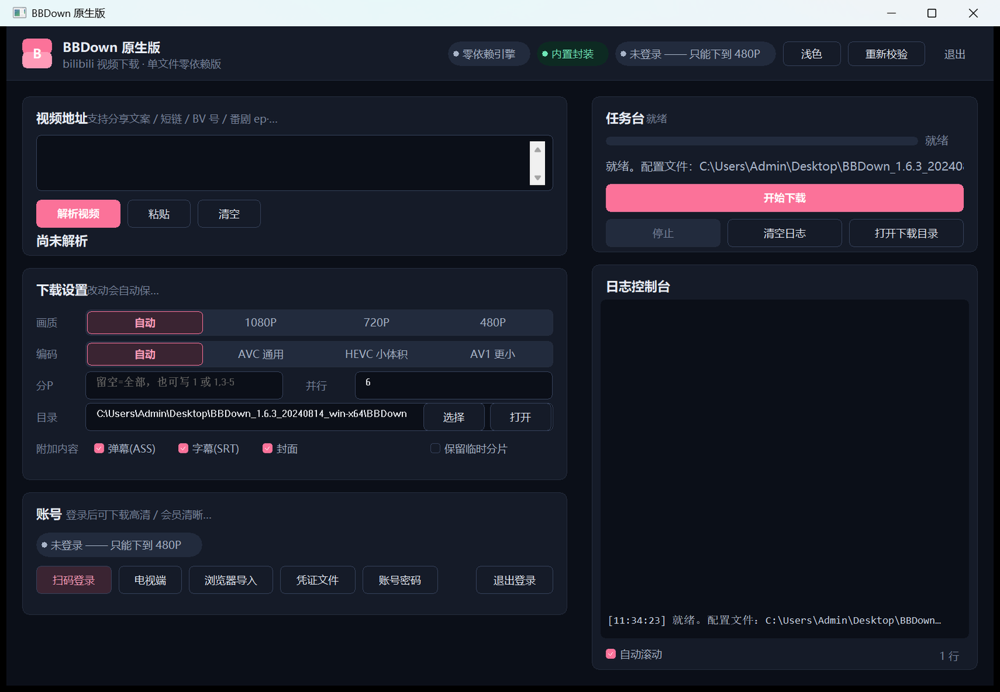
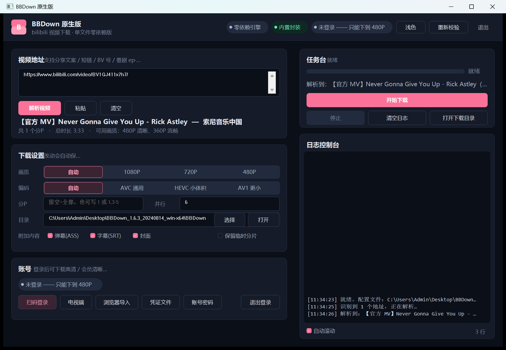
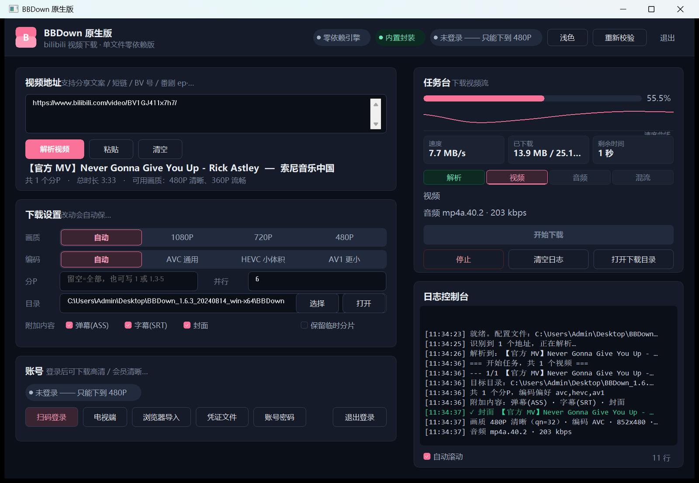

# BBDown GUI — 哔哩哔哩视频下载图形界面

B 站视频下载器，**纯 Go 单文件实现**：双击即用，不装 Python、不装 ffmpeg、
不需要命令行黑窗。

- 地址粘贴 → 解析 → 下载 → 纯 Go 封装成可直接播放的 MP4，全在一个窗口里完成
- 下载核心零运行时依赖；「刷视频 / 登录」两页用系统自带的 WebView2
  （Windows 11 预装，Windows 10 可单独安装），缺它只影响这两页
- 发行版：[Releases](https://github.com/amo-tx/BBDown-GUI/releases)

## 运行截图

**空闲态** —— 双击即用，单文件零依赖：



**解析完成** —— 标题、UP主、时长、可用画质完整分行显示：



**下载中** —— 空心平滑速度曲线、速度 / 已下载 / 剩余时间三张指标卡、
解析→视频→音频→混流阶段步进器、实时日志：



## 功能

- **地址解析**：支持分享文案 / 短链 / BV 号 / 番剧 ep·ss，一段话里多个地址依次下载
- **下载设置**：画质优先级（**自动 / 4K / 1080P / 720P / 480P**，需登录解锁高画质）、
  编码优先级（默认 AVC 通用，规避 B 站客户端播放 HEVC 全黑问题）、
  分 P 范围（支持 `1,3-5` 写法）、并行数、仅视频/仅音频/弹幕/字幕/封面
- **任务台**：实时进度条、**空心平滑速度曲线**、速度 / 已下载 / 剩余时间指标卡、
  **阶段步进器**（解析→视频→音频→混流）、常驻阶段行、实时日志（自动滚动开关 + 行数统计）
- **刷视频**：连续浏览视频卡片，点一个就地预览；源可切「热门」（免登录）
  或「个性化推荐」（需登录）。预览**自动取当前账号能拿到的最高画质**，
  采用 MSE 拼接 B 站 DASH 视频+音频流，**边下边播**（缓冲到 0.6 秒就开播，
  4K 也只等两三秒），缓冲领先 40 秒自动背压，播起来后预取下一支；热门列表与
  解析结果有短缓存。两种浏览方式：**精选**（紧凑列表 + 播放器同屏）与
  **首页**（分类导航 + 封面瀑布流 + 播放层）。看中哪个点「一键下载」，
  窗口自动切到下载页签，任务跑在主窗口的任务台上
- **登录页**：扫码登录 / 电视端 / 浏览器导入 / 凭证文件 / 账号密码五种方式，
  外加「手动 Cookie」。二维码、浏览器配置读取、账号密码全部在本进程内完成，
  凭证只写本地 `config.json`；切回下载页时自动同步给下载引擎
- **音频转文字**：优先用 B 站字幕（AI 字幕 / UP 主上传）；B 站没有字幕时自动托底
  ——下载音频、纯 Go 解码成 16kHz WAV，交给本地 whisper.cpp 转写（首次使用自动
  下载 whisper-cli + 量化语音模型到 `%LOCALAPPDATA%\BBDown-Native\asr`，
  之后离线可用）
- **AI 总结**：把文稿交给 AI 生成摘要 + 带时间戳的大纲与要点。默认走
  **智谱 GLM-4-Flash（永久免费）**，在 config.json 填 `ai_key` 即启用
  （`ai_base`/`ai_model` 可换任何 OpenAI 兼容服务）；没填 key 或主路失败时
  兜底免 key 网关。点「AI 总结」时文稿先落盘，总结失败也不丢转写结果
- **浅色 / 深色双主题**，一键切换，偏好记忆
- **mp4 封装质量**：与 `ffmpeg -c copy` 参照做三级 framecrc diff 全零对齐（有测试锁定）

## 构建

```bash
cd BBDown-Native
source tools/goenv.sh   # 配置 Go 环境（Windows）
go build -trimpath -ldflags "-s -w -H=windowsgui" -o "dist/BBDown原生版.exe" ./cmd/bgui
```

要求：Go 1.26+，`CGO_ENABLED=0`，纯 Go 编译链，不需要 MSVC / gcc。
第三方依赖仅 6 个（`lxn/walk`、`lxn/win`、`jchv/go-webview2`、`skip2/go-qrcode`、
`tphakala/go-aac`、`golang.org/x/sys`），`internal/server/` 一层零第三方依赖。

## 测试与验证

```bash
go test ./...          # 全量单元测试（含 mp4 封装、编码偏好防回退等）
go vet ./...           # 静态检查
go run ./cmd/e2e       # 离线封装回归（用 .devdata/ 里的 m4s 样例）
node tools/uitest.mjs  # 界面冒烟（需先起 -ui browser -no-open 的本地服务）
```

更多 GUI 自动化脚本见 [`BBDown-Native/README.md`](BBDown-Native/README.md) 的「验证」一节。

## 安全说明

- 本地服务只监听 `127.0.0.1`，等同本地程序；写接口带自定义头做 CSRF 防护
- 登录凭据明文保存在 exe 同目录的 `config.json` / `*.data`（与 BBDown 官方行为一致），
  **请勿把这两个文件分享给任何人**；`.gitignore` 已在任意层级忽略它们
- 推送前有三道凭据扫描（文件名 / diff 内容 / 远端树复核）

## 目录结构

```
.
├─ BBDown-Native/          # 全部源码
│  ├─ cmd/bgui/            #   程序入口
│  ├─ cmd/e2e/             #   端到端验证（离线封装回归 + 带网真实下载）
│  ├─ internal/gui/        #   Win32 自绘界面（布局 / 绘制 / WebView2 宿主）
│  ├─ internal/app/        #   任务调度、配置、AI 总结
│  ├─ internal/bilibili/   #   B 站接口（解析、登录、画质选择、刷视频源）
│  ├─ internal/mux/        #   纯 Go fMP4 → MP4 封装
│  ├─ internal/server/     #   本地 HTTP 接口 + 前端（go:embed）
│  ├─ tools/               #   构建环境与 GUI 自动化验证脚本
│  └─ dist/                #   构建产物（不入库，双击运行的 exe 在这里）
└─ docs/screenshots/       # README 运行截图
```

## License

仅供学习交流，请遵守 B 站用户协议，勿用于商业用途。
